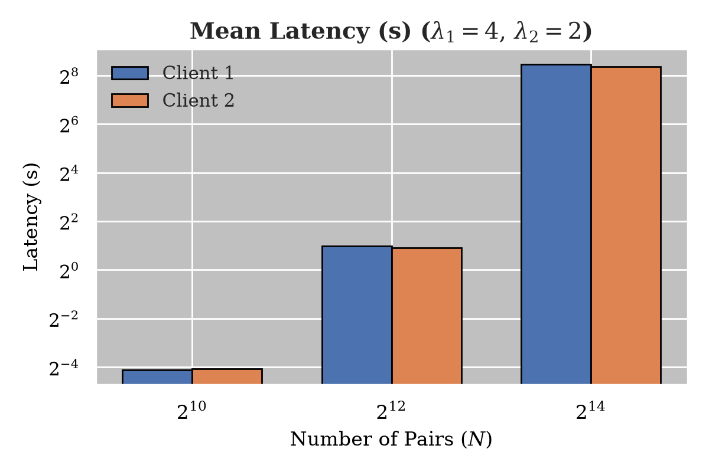
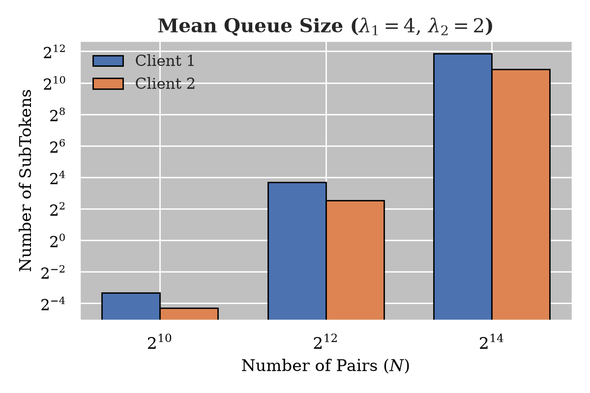

# TigroEXH

Experiment harness for the encrypted multi-map (EMM) behind **TIGRO**
(*Trust Infrastructure for Grassroots Organizing via Grounded Digital Annotations*, PETS 2026).
It measures what the EMM's queue-based query processing (the *EXH* mode) costs in
latency and queue size under Poisson query arrivals, with a Path ORAM storage server
as the back end.

The EMM design itself is described in the paper; this repository holds the benchmark
driver, the storage server, the raw measurements and the plotting script.

## What is measured

Two clients issue keyword queries over an inverted index of *N* keyword/document pairs,
with exponentially distributed inter-arrival times of rate λ. A proxy thread turns each
query into a stream of fixed-size sub-tokens (real ones padded with dummies) that is
served from a queue, and a storage server answers the resulting Path ORAM accesses over
TCP. The harness records, per client, the end-to-end query latency and the number of
sub-tokens waiting in the queue.

Runs cover *N* ∈ {2¹⁰, 2¹², 2¹⁴} and λ ∈ {2, 4}, plus an asymmetric case where the two
clients query at λ₁ = 4 and λ₂ = 2. Each client issues 5 000 queries after 100 warm-up
queries.

## Results

| Mean latency, λ₁ = 4, λ₂ = 2 | Mean queue size, λ₁ = 4, λ₂ = 2 |
| --- | --- |
|  |  |

The full measurements (λ, server rate μ, utilisation ρ, real and dummy sub-token counts,
bandwidth overhead, latency percentiles, queue statistics) are in `TigroEXH.xlsx`.
`PlotQueueMetrics.py` regenerates every figure (mean, median, 75th percentile, max and
standard deviation of latency; mean, max and standard deviation of queue size) as PDF:

```sh
pip install numpy pandas seaborn matplotlib
python PlotQueueMetrics.py
```

## Layout

| Path | Role |
| --- | --- |
| `client/ClientPerf.cpp` | Benchmark driver: loads the inverted index from JSON, prints its statistics (max response length, number of pairs, E[X²]), starts the proxy and the two Poisson clients, measures latency. |
| `sserver/Server.cpp` | Storage server (Asio, port 8900): receives the ORAM parameters and the encrypted map, loads the serialized ORAM tree, then serves Path ORAM read/write-back rounds. |
| `client/leaf_service.proto`, `client/client.cc` | gRPC prototype of the same leaf/path exchange (`ProcessLeaf`, `SendPath`), with the generated stubs checked in. |
| `PlotQueueMetrics.py` | Plotting script for the latency and queue-size figures. |
| `TigroEXH.xlsx` | Raw measurements. |

## Building

The two Visual Studio projects (`client/client.vcxproj`, `sserver/sserver.vcxproj`) target
MSVC v143 / C++20 and link OpenSSL 3, Asio, cereal, nlohmann/json and, for the gRPC
prototype, gRPC and protobuf through vcpkg.

They include `Lat.h` (the `LAT` class: EMM client, proxy and queue) and `PathOram.h` from
the EMM core, which lived in a separate `SynVHQ` module that is not published here. The
input dataset (`MM/MM/*.json`) and the serialized ORAM tree (`serialized_data.bin`) are
not included either. This repository therefore does not build on its own; it is published
as a record of the experimental setup and of the measurements.

## Links

- Paper: [TIGRO, PoPETs 2026](https://petsymposium.org/popets/2026/popets-2026-0052.php)
- Paper artifact: [tigro-project/artifact](https://github.com/tigro-project/artifact)
- Author: [Amine Bahi](https://www.aminebahi.com)
